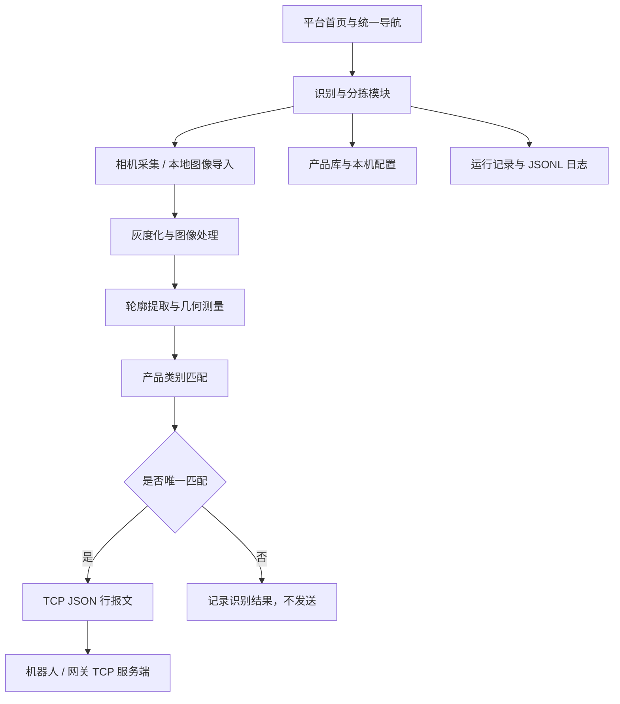

# 数字孪生工业自动化控制平台

<p align="center">
  <strong>Digital Twin Industrial Automation Platform</strong>
</p>

<p align="center">
  基于 C#、WPF、.NET 10 和 OpenCvSharp 的工业自动化应用平台
</p>

<p align="center">
  
  
  
  
  
</p>

**[查看源代码](https://github.com/Nadoric/DigitalTwinIndustrialAutomationPlatform)** · [相机兼容说明](CAMERA_SUPPORT.md) · [机器人通信协议](ROBOT_PROTOCOL.md) · [模块扩展指南](MODULE_EXTENSION_GUIDE.md)

## 项目简介

数字孪生工业自动化控制平台是一个基于 C# WPF 的 Windows 桌面应用，采用模块化组织方式，为后续扩展工业视觉、设备监控及自动化业务提供统一的平台入口。

当前版本已经接入 **识别与分拣系统**，将相机采集、图像处理、产品建档、几何特征匹配和机器人 TCP 通信整合到一个应用中。

使用者可以导入产品图片或连接摄像头，通过滤波、边缘检测和轮廓提取计算产品的面积与周长，再将测量结果与预先建立的产品类别进行比较。匹配成功后，平台通过 TCP 发送产品类型信息，供机器人或网关侧程序处理。

平台同时保留独立的模块注册机制，新增业务模块时可以沿用首页、侧边栏和统一导航结构。

> **当前版本说明**
>
> 本项目目前以桌面平台框架和二维机器视觉识别为主要实现内容。三维数字孪生场景、PLC 通信驱动、机器人运动控制及真实产线联动仍需后续开发接入。

## 核心功能

| 功能模块 | 主要能力 |
| --- | --- |
| 平台框架 | 首页、侧边栏、模块导航、设置和关于页面 |
| 产品建档 | 摄像头拍照、本地图像导入、轮廓测量、产品类别保存 |
| 图像处理 | 灰度化、滤波、边缘检测、阈值分割、形态学处理 |
| 产品识别 | 基于轮廓面积、周长及可配置误差范围进行类别匹配 |
| 相机管理 | 设备枚举、相机选择、预览、拍照及设备释放 |
| 自动识别 | 周期采样、连续识别、结果统计、异常记录 |
| 机器人通信 | TCP 客户端、UTF-8 JSON 行报文、断线及发送错误处理 |
| 运行记录 | JSONL 完整日志、最近采样记录展示、日志导出 |
| 模块扩展 | 统一模块注册，支持后续接入独立 WPF 业务视图 |
| 软件发布 | Windows x64 自包含发布、ZIP 打包及 SHA-256 校验 |

## 识别与分拣系统

识别与分拣系统是当前已经接入平台的主要业务模块。

### 1. 图像采集

支持两种产品图像来源：

- **摄像头采集**：连接兼容的 Windows 摄像头，获取实时画面或拍摄产品照片。
- **本地图像导入**：导入 JPG、JPEG、PNG、BMP、TIF、TIFF 格式的图片，离线完成产品建档。

相机选择使用独立窗口管理，可以查看设备名称、接口、状态和设备标识。程序会在实际取得有效图像后确认连接状态。

摄像头的选择信息可以保存到本机。切换产品类别时，程序会保留当前选择的相机；设备被拔出后，需要重新选择，避免静默切换到其他摄像头。

### 2. 图像处理

平台基于 OpenCvSharp 实现图像处理流程，支持按需要调整处理算法及参数。

| 处理类别 | 支持的算法或操作 |
| --- | --- |
| 平滑滤波 | 高斯滤波、中值滤波、双边滤波、均值滤波 |
| 一阶微分 | Sobel、Scharr、Prewitt、Roberts |
| 二阶微分 | Laplacian、LoG |
| 边缘检测 | Canny 及多种梯度、微分算子 |
| 图像分割 | 固定阈值、阈值区间、Otsu 自动阈值 |
| 形态学处理 | 开运算、闭运算、腐蚀、膨胀 |
| 轮廓测量 | 外轮廓提取、面积计算、闭合周长计算 |
| 其他工具 | 灰度预览、直方图、模板匹配及图像文件处理 |

滤波、边缘检测、轮廓提取等操作具有独立的参数设置入口，可以分别调整核大小、阈值、Sigma、最小轮廓面积等参数。

所有图像处理入口统一先转换为灰度图，再执行对应算法。产品建档和自动识别共用同一套处理实现，减少两种流程之间的算法差异。

### 3. 产品建档

每个产品类别保存独立的参考图像、测量特征和处理配方。

建档流程如下：

1. 拍摄产品或导入本地图像。
2. 选择滤波算法及轮廓提取参数。
3. 执行滤波与轮廓测量。
4. 检查有效轮廓数量及测量结果。
5. 填写产品类别名称并选择保存目录。
6. 保存产品类别，供后续识别使用。

建档时，图像中必须恰好存在一个满足最小面积要求的有效轮廓。存在多个有效轮廓时，需要调整图像处理参数后重新测量。

每个产品类别保存为独立目录，结构如下：

```text
product_产品名称_GUID/
├── product.json     # 产品 ID、名称、参考特征和处理配方
├── original.png     # 原始产品图像
├── processed.png    # 轮廓标注及测量结果图
└── binary.png       # 轮廓提取使用的二值图
```

产品参数包含参考面积、参考周长、图像分辨率及对应的处理配方。产品类别保存到用户指定的目录中，平台通过本机索引恢复已登记的产品库。

加载产品库时，可以选择单个产品类别目录，也可以选择包含多个类别的根目录。

### 4. 自动产品识别

自动识别采用基于几何特征的匹配方式。

程序持续获取相机画面，按照设定的采样频率提取图像，并使用产品类别各自保存的处理配方计算轮廓面积与周长。

面积误差计算公式：

```text
面积误差(%) =
    |当前面积 - 参考面积| / 参考面积 × 100%
```

周长误差计算公式：

```text
周长误差(%) =
    |当前周长 - 参考周长| / 参考周长 × 100%
```

只有当面积误差和周长误差均满足配置范围，并且恰好匹配一个产品类别时，程序才会判定识别成功。

以下情况不会发送产品类别报文：

- 未检测到有效目标。
- 画面中存在多个有效目标。
- 没有任何产品类别满足误差范围。
- 多个产品类别同时满足匹配条件。
- 当前图像分辨率与产品库要求不一致。

自动识别频率可配置为 **0.1～20 Hz**。识别任务串行执行，不会无限积压待处理帧；当处理速度跟不上目标频率时，会跳过错过的采样时刻。

需要注意，当前识别主要依据轮廓面积和周长，适合轮廓特征有明显区别的产品。对于形状相近的零件，还需要结合实际样本评估误判风险。

## 自动化通信

### 机器人 TCP 通信

平台作为 TCP 客户端，连接运行在机器人或网关侧的 TCP 服务端。

连接参数包括：

- 机器人或网关的 IP 地址、域名。
- TCP 端口。
- 产品面积误差范围。
- 产品周长误差范围。
- 自动采样频率。

识别成功后，平台发送一条 UTF-8 编码的 JSON 报文，并以换行符 `\n` 作为消息结束标记。

报文采用 NDJSON 格式，每行一个独立的 JSON 对象。

```json
{
  "type": "product_recognized",
  "version": 1,
  "runId": "a5dbb3c3-6289-43d2-804a-cde4b075ac8b",
  "sequence": 12,
  "timestamp": "2026-10-18T08:00:00+00:00",
  "productId": "c2829863-0224-46c7-b80e-95cadb47a80e",
  "productType": "螺栓A",
  "areaPx2": 6894.0,
  "perimeterPx": 331.5,
  "areaErrorPercent": 1.1,
  "perimeterErrorPercent": 0.7
}
```

主要字段说明：

| 字段 | 含义 |
| --- | --- |
| `type` | 消息类型，固定为 `product_recognized` |
| `version` | 协议版本，当前为 `1` |
| `runId` | 本次自动识别任务的运行 ID |
| `sequence` | 本次运行的采样序号 |
| `timestamp` | 报文发送时间，采用 UTC ISO 8601 格式 |
| `productId` | 产品类别的稳定 GUID |
| `productType` | 产品类别名称 |
| `areaPx2` | 当前轮廓面积，单位为像素平方 |
| `perimeterPx` | 当前闭合轮廓周长，单位为像素 |
| `areaErrorPercent` | 面积相对误差百分比 |
| `perimeterErrorPercent` | 周长相对误差百分比 |

TCP 是字节流协议，接收端必须按换行符进行消息分帧，不能假定一次 Socket 接收就对应一条完整报文。

**当前通信仅发送产品识别结果，不包含机器人运动轨迹、目标坐标、速度或直接运动指令。** 机器人侧需要自行解析产品类型，并映射到对应的分拣程序。

当前协议没有 ACK 或分拣完成反馈。平台显示报文已写入 TCP，只代表本机网络写入成功，不能据此确认机器人已经接收或完成动作。

连接中断或写入失败时，平台会停止自动识别，不自动重发或重连，避免在执行状态未知时重复触发。

详细协议见 [ROBOT_PROTOCOL.md](ROBOT_PROTOCOL.md)。

### 本机模拟机器人

项目提供 Python 标准库实现的 TCP 服务端，用于验证通信格式和接收流程。

启动模拟服务端：

```powershell
python .\tools\robot_tcp_simulator.py --host 127.0.0.1 --port 5000
```

然后在平台中填写：

```text
IP 地址：127.0.0.1
TCP 端口：5000
```

点击“连接机器人”，再启动自动识别。模拟服务端会在终端打印收到的产品类别、ID、采样序号、面积和周长。

模拟服务端只接收并打印报文，不会生成视觉识别结果，也不会控制任何机器人设备。

## 系统架构



### 技术栈

| 技术 | 用途 |
| --- | --- |
| C# | 业务逻辑及设备通信 |
| WPF | Windows 桌面界面 |
| .NET 10 | 应用运行时及构建框架 |
| OpenCvSharp 4.13 | 图像采集、图像处理与轮廓测量 |
| System.Management | Windows 设备清单查询 |
| TCP / JSON / NDJSON | 机器人或网关侧的结果通知 |
| Python 3 | 可选的本机 TCP 模拟服务端 |

平台模块采用编译期注册方式。各模块可以拥有独立的 WPF 视图，并通过统一的模块定义接入首页与侧边栏。

当前模块注册机制不包含动态 DLL 插件加载功能。

## 环境要求

运行和开发需要以下环境：

- Windows 10/11 x64。
- .NET 10 SDK。
- 支持 .NET 10 的 Visual Studio，或其他可使用 .NET CLI 的开发环境。
- 能够访问 NuGet 源的网络环境，用于还原依赖。
- 使用真实相机时，需要兼容的 Windows 摄像头驱动。

主要依赖版本：

```text
Target Framework: net10.0-windows
Platform:         x64
Runtime:          win-x64
OpenCvSharp4:     4.13.0.20260627
```

## 快速开始

### 1. 克隆项目

```powershell
git clone https://github.com/Nadoric/DigitalTwinIndustrialAutomationPlatform.git

cd DigitalTwinIndustrialAutomationPlatform
```

### 2. 还原依赖

```powershell
dotnet restore .\DigitalTwinIndustrialAutomationPlatform.csproj
```

### 3. 编译项目

```powershell
dotnet build .\DigitalTwinIndustrialAutomationPlatform.csproj -c Debug
```

### 4. 启动应用

```powershell
dotnet run --project .\DigitalTwinIndustrialAutomationPlatform.csproj
```

启动后，平台默认进入首页，可以从应用模块区域进入“识别与分拣系统”。

首次使用时，建议先导入一张产品图片，完成轮廓测量和产品建档，再配置相机及机器人通信参数。

### 5. 运行逻辑验证

项目提供独立的验证程序，可在 Windows 开发环境中运行：

```powershell
dotnet run --project .\tests\Verify.csproj
```

该程序用于检查相关算法、识别逻辑、设备标识处理及通信等纯逻辑行为。验证结果不能替代真实摄像头驱动、机器人控制器和产线环境的联调测试。

## 一键发布

项目提供 `Publish.cmd` 和 `Publish.ps1`，用于生成 Windows x64 自包含发布包。

使用默认版本：

```powershell
.\Publish.cmd
```

指定版本号：

```powershell
.\Publish.cmd 1.0.1
```

也可以直接使用 PowerShell：

```powershell
powershell.exe -NoProfile -ExecutionPolicy Bypass -File .\Publish.ps1 -Version 1.0.1
```

发布脚本会执行以下操作：

1. 检查 .NET 10 SDK。
2. 以 Release 配置发布 Windows x64 自包含程序。
3. 检查主程序、.NET、WPF 和 OpenCvSharp 原生依赖。
4. 将发布目录完整打包为 ZIP。
5. 检查 ZIP 内文件是否可读取。
6. 生成 SHA-256 校验文件。

生成目录示例：

```text
artifacts/
└── v1.0.1_日期时间_随机编号/
    ├── publish/
    ├── DigitalTwinIndustrialAutomationPlatform_v1.0.1_win-x64.zip
    └── DigitalTwinIndustrialAutomationPlatform_v1.0.1_win-x64.zip.sha256
```

将 ZIP 解压到本地目录后，运行：

```text
DigitalTwinIndustrialAutomationPlatform.exe
```

**请完整解压并保留所有 DLL 和子目录，不要只复制 EXE 文件。**

发布脚本只负责生成软件包，不会自动创建 GitHub Release 或上传文件。若在其他 Windows 电脑上遇到 OpenCvSharp 原生库加载失败，可以检查 Microsoft Visual C++ x64 Redistributable 是否已安装。

## 项目目录

```text
DigitalTwinIndustrialAutomationPlatform/
├── App.xaml                         # WPF 应用入口
├── MainWindow.xaml                  # 平台主界面
├── MainWindow.xaml.cs               # 主窗口逻辑
├── MainWindow.Modules.cs            # 模块注册
├── MainWindow.Navigation.cs         # 页面导航
├── MainWindow.Cameras.cs            # 相机交互
├── MainWindow.Recognition.cs        # 识别与分拣业务
├── MainWindow.Commands.cs           # 界面命令
├── MainWindow.Settings.cs           # 设置相关逻辑
├── Platform/
│   ├── ModuleDefinition.cs           # 模块定义
│   └── PlatformInfo.cs               # 平台信息
├── Cameras/
│   ├── CameraCaptureFactory.cs       # 相机打开与取流
│   ├── CameraDeviceInfo.cs           # 设备信息与标识
│   ├── CameraDiscovery.cs            # 设备发现
│   └── DirectShowCameraEnumerator.cs # DirectShow 枚举
├── Recognition/
│   ├── AutomaticRecognition.cs       # 自动识别循环
│   ├── ProductModels.cs              # 产品与识别模型
│   ├── ProductPipeline.cs             # 识别处理流程
│   ├── ProductStore.cs                # 产品类别持久化
│   └── TcpRobotClient.cs              # TCP 通信客户端
├── Services/
│   ├── ImageAlgorithms.cs             # 图像算法
│   ├── ImageProcessor.cs              # 图像处理
│   ├── OpenCvImageService.cs          # 图像服务
│   └── ShutdownCoordinator.cs         # 退出与资源协调
├── Models/
│   └── AppModels.cs                   # 图像及处理参数模型
├── Views/
│   ├── CameraConnectionWindow.cs      # 相机连接窗口
│   ├── ProcessingSettingsWindow.cs    # 处理参数设置
│   └── SettingsEditor.cs              # 设置编辑
├── Assets/                            # 平台图标等资源
├── tests/                             # 逻辑验证程序
├── tools/
│   ├── robot_tcp_simulator.py         # TCP 模拟服务端
│   └── generate_platform_icon.py      # 图标生成工具
├── CAMERA_SUPPORT.md                  # 相机兼容说明
├── MODULE_EXTENSION_GUIDE.md          # 模块扩展指南
├── ROBOT_PROTOCOL.md                  # TCP 报文协议
├── README_OpenCvSharp.md              # 详细使用与开发说明
├── Publish.cmd                        # 发布入口
├── Publish.ps1                        # 发布与打包脚本
└── DigitalTwinIndustrialAutomationPlatform.csproj
```

## 本地数据与运行日志

平台会将配置和索引保存在当前 Windows 用户目录下，产品图像则存储在用户指定的位置。

| 数据 | 默认位置 |
| --- | --- |
| 自动识别与机器人参数 | `%LOCALAPPDATA%\DigitalTwinIndustrialAutomationPlatform\recognition-automation.json` |
| 产品库索引 | `%LOCALAPPDATA%\DigitalTwinIndustrialAutomationPlatform\product-library.json` |
| 自动识别日志 | `%LOCALAPPDATA%\DigitalTwinIndustrialAutomationPlatform\run-logs\` |
| 原有视觉处理参数 | `%LOCALAPPDATA%\ProductIdentificationSorting\settings.json` |

自动识别期间，界面保留最近 300 条采样记录；完整记录按 JSON Lines 格式持续写入日志。停止识别后，可以通过“运行记录”页面导出完整日志。

产品库索引记录产品类别目录的位置。移动或删除原产品目录后，需要重新导入对应产品类别。

## 扩展平台模块

平台通过统一的模块注册入口管理首页卡片和侧边栏导航。

新增模块时，可以创建独立的 WPF `UserControl`，并在 `MainWindow.Modules.cs` 的 `InitializeModules()` 中注册模块定义及对应视图。

示例：

```csharp
RegisterModule(
    new ModuleDefinition(
        "equipment-monitoring",
        "设备监控",
        "设备状态采集与运行信息展示。",
        "\uE713"),
    new Modules.EquipmentMonitoring.EquipmentMonitoringView());
```

上面仅展示模块注册方式。设备监控视图需要自行实现，当前项目没有内置该业务模块。

新增模块时，还需要根据自身业务处理后台任务、设备连接、参数持久化和退出时的资源释放。

详细步骤见 [MODULE_EXTENSION_GUIDE.md](MODULE_EXTENSION_GUIDE.md)。

## 已知限制

当前版本仍有以下边界：

- **三维数字孪生**：暂未实现三维工厂、设备模型、实时状态映射或三维仿真场景。
- **PLC 通信**：没有内置 S7、Modbus、OPC UA 等 PLC 或工业协议驱动。
- **机器人控制**：目前通过 TCP 发送产品类别信息，运动控制及分拣执行由外部接收端负责。
- **视觉算法**：当前主要基于轮廓面积与周长匹配，不包含深度学习模型或通用目标检测模型。
- **尺寸标定**：面积单位为 px²，周长单位为 px，尚未转换为毫米等物理单位。
- **相机兼容性**：普通摄像头和提供 DirectShow 驱动的设备可尝试使用；纯 GigE Vision、GenICam 或厂商专有相机通常需要额外的 SDK 适配。
- **识别稳定性**：建档与识别应尽量保持相机分辨率、视距、角度、焦距、照明和背景一致。
- **重复识别**：同一产品持续留在画面中时，可能在每个采样周期重复发送。当前没有到料触发、产品取走检测或一物一件去重机制。
- **通信确认**：当前没有机器人 ACK、执行完成确认或自动重发机制。
- **实机验证**：逻辑验证不能代替不同相机、驱动和真实机器人控制器的现场测试。

如果用于真实产线，需要根据实际设备补齐通信适配、安全联锁、异常恢复、重复触发防护和现场验证。

## 相关文档

- [相机连接与兼容范围](CAMERA_SUPPORT.md)
- [机器人 TCP 报文协议 v1](ROBOT_PROTOCOL.md)
- [平台模块扩展指南](MODULE_EXTENSION_GUIDE.md)
- [OpenCvSharp 使用与开发说明](README_OpenCvSharp.md)

## 参与贡献

欢迎围绕图像处理、产品识别、相机适配、平台模块、通信接口和测试等方向提交 Issue 或 Pull Request。

提交新功能时，建议同时说明：

- 目标场景与实际需求。
- 涉及的设备、驱动或协议。
- 复现步骤及预期结果。
- 是否需要修改现有配置或通信协议。
- 已完成的自动化验证及尚未覆盖的实机测试。

## 许可证

当前仓库尚未发现明确的 `LICENSE` 文件。使用、修改、分发或将项目集成到商业产品前，请先与项目维护者确认授权，并建议为仓库补充正式的开源许可证。

---

<p align="center">
  <strong>Digital Twin Industrial Automation Platform</strong><br />
  面向工业视觉识别与自动化业务扩展的 Windows 桌面平台
</p>
